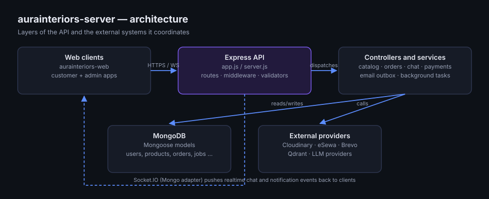
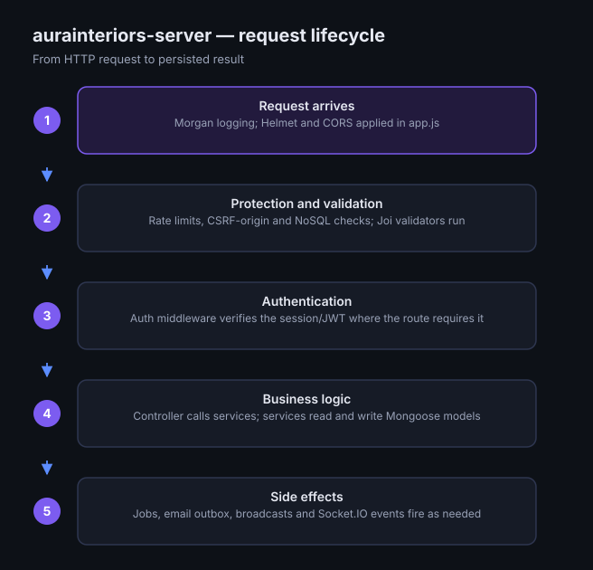

<div align="center">

<h1>aurainteriors-server</h1>

**Backend API for Aura Interiors — catalog, commerce, chat and realtime services.**

An Express and MongoDB service powering the Aura Interiors storefront and admin console, with Socket.IO chat, eSewa payments and a background job worker.

  

[Quick start](#quick-start) · [How it works](#how-it-works) · [Features](#features)

<code>npm install && npm start</code>

</div>

> [!WARNING]
> The repository's own `Dockerfile` header states the image was authored without a container runtime available and has **never been built or booted**. Treat the first `docker build` as a verification step.


## Overview

This repository is the backend for Aura Interiors. `server.js` starts the HTTP API defined in `app.js`; a separate `worker.js` entry runs background jobs. The codebase is layered as routes → middleware → controllers → services → Mongoose models, with configuration in `config/` and validation in `validators/`.

It serves the [aurainteriors-web](https://github.com/ShahiCrafts/aurainteriors-web) frontend: product catalog and categories, carts and orders, eSewa payment capture and verification, reviews and wishlists, customer support chat over Socket.IO (with AI-assisted replies and Qdrant-backed retrieval), notifications, and an email outbox delivered through Brevo.

## Features

- **Catalog** — products, variants, categories, collections, attributes and faceted filtering, with a seeded catalog taxonomy (`config/catalog*`, `scripts/ensureCatalog.js`)
- **Commerce** — carts, checkout support, orders, discounts and promotions
- **Payments** — eSewa capture and verification services
- **Auth** — JWT sessions plus Google OAuth (Passport), with auth-attempt tracking and rate-limited auth routes
- **Chat** — Socket.IO messaging with uploads, plus AI chat services (multiple LLM providers) and Qdrant vector retrieval
- **Notifications and email** — notification routes, device push tokens, and a Brevo-backed email outbox
- **Background work** — `worker.js` and job/broadcast services poll and process queued work
- **Hardening** — Helmet, CORS, CSRF-origin checks, rate limiting (including a Mongo-backed store), NoSQL sanitization, Joi validation, audit logging

## How it works

Requests enter through `app.js`, pass the middleware stack (auth, rate limits, CSRF-origin, validation, error handling), reach a controller, and run business logic in services over Mongoose models. Realtime chat runs on Socket.IO with a Mongo adapter so multiple instances can share events; long-running work is handed to the worker process.



[Open the full-size figure](docs/assets/architecture.svg)

The lifecycle of one API request:



[Open the full-size figure](docs/assets/workflow.svg)

## Tech stack

| Area | Technology | Notes |
| --- | --- | --- |
| Runtime | Node.js | Entries: `server.js` (API) and `worker.js` (jobs) |
| Framework | Express | App assembled in `app.js` |
| Database | MongoDB via Mongoose | Models at the repository root level (`models/`) |
| Realtime | Socket.IO + @socket.io/mongo-adapter | Chat and notifications across instances |
| Auth | Passport (Google OAuth 20), jsonwebtoken, bcrypt | Session and token auth |
| Media and files | Cloudinary, Multer, Sharp | Uploads and image processing |
| Payments | eSewa | Capture and verification services in `services/` |
| Email | Brevo API | Email service and outbox |
| AI / retrieval | Qdrant client, LLM provider keys | Chat assistance and embeddings (see environment) |
| Validation | Joi | Validators in `validators/` |

## Project structure

```text
aurainteriors-server/
├── server.js             API entry point
├── worker.js             Background job worker entry
├── app.js                Express app assembly
├── config/               App config, database, Passport, Cloudinary, catalog data
├── routes/               Route modules per resource
├── middleware/           Auth, rate limits, CSRF, uploads, validation, errors
├── controllers/          Request handlers per resource
├── services/             Business logic, chatV2/, email, payments, catalog …
├── models/               Mongoose models
├── validators/           Joi validators
├── utils/                Errors, tokens, caching, guest sessions, fetch guards …
├── scripts/              Seed, catalog migration, admin creation, audits
├── tests/                Audit, auth, chatV2, fresh, happy, perf, platform suites
├── Dockerfile            See the warning above — not yet build-verified
└── package.json
```

## Quick start

### Prerequisites

- Node.js and npm
- A MongoDB instance (`MONGO_URI`)

### Install and run

```bash
npm install
cp .env.example .env   # fill in the values
npm start
```

Development (auto-restart) and seeding:

```bash
npm run dev
npm run seed
```

### Environment variables

Names below come from `.env.example` (80+ variables). Names only — never commit real values.

<details>
<summary><strong>Variable names (from the repository)</strong></summary>

- `PORT`
- `NODE_ENV`
- `MONGO_URI`
- `MONGO_DB_NAME`
- `MONGO_MAX_POOL_SIZE`
- `MONGO_MIN_POOL_SIZE`
- `MONGO_CONNECT_RETRIES`
- `JWT_SECRET`
- `JWT_EXPIRES_IN`
- `JWT_COOKIE_EXPIRES_IN`
- `FRONTEND_URL`
- `ADMIN_URL`
- `BACKEND_URL`
- `GOOGLE_CLIENT_ID`
- `GOOGLE_CLIENT_SECRET`
- `BREVO_API_KEY`
- `BREVO_API_BASE_URL`
- `BREVO_TIMEOUT_MS`
- `EMAIL_FROM`
- `SUPPORT_EMAIL`
- `EMAIL_LOGO_URL`
- `EMAIL_MODE`
- `CLOUDINARY_CLOUD_NAME`
- `CLOUDINARY_API_KEY`
- `CLOUDINARY_API_SECRET`
- `CLOUDINARY_TIMEOUT_MS`
- `ESEWA_MERCHANT_ID`
- `ESEWA_SECRET_KEY`
- `ESEWA_ENV`
- `QDRANT_URL`
- `QDRANT_API_KEY`
- `EMBEDDING_API_URL`
- `EMBEDDING_MODEL_NAME`
- `EMBEDDING_VECTOR_SIZE`
- `NVIDIA_API_KEY`
- `OPENROUTER_API_KEY`
- `GEMINI_API_KEY`
- `GROQ_API_KEY`
- `MISTRAL_API_KEY`
- `GROQ_CHAT_MODEL`
- `MISTRAL_CHAT_MODEL`
- `OPENROUTER_CHAT_MODEL`
- `GROQ_BASE_URL`
- `MISTRAL_BASE_URL`
- `OPENROUTER_BASE_URL`
- `CHAT_TOOL_TIMEOUT_MS`
- `CHAT_MAX_TOKENS`
- `CHAT_TEMPERATURE`
- `CHAT_MAX_TOOL_ROUNDS`
- `CHAT_MAX_CONCURRENT_TURNS`
- `CHAT_LLM_STREAM_TIMEOUT_MS`
- `GUEST_SESSION_TTL_MODE`
- `GUEST_STOCK_RESERVATION_TTL_MINUTES`
- `GUEST_COD_HOLD_RELEASE_HOURS`
- `CATEGORY_SVG_POLICY`
- `ANALYTICS_CACHE_TTL_MS`
- `SOCKET_REVALIDATE_INTERVAL_MS`
- `SOCKET_ADAPTER`
- `RATE_LIMIT_STORE`
- `RATE_LIMIT_WINDOW_MS`
- `RATE_LIMIT_READ_MAX`
- `RATE_LIMIT_WRITE_MAX`
- `WORKER_MODE`
- `BROADCAST_MODE`
- `JOB_POLL_MS`
- `JOB_CONCURRENCY`
- `JOB_VISIBILITY_MS`
- `JOB_BACKOFF_BASE_MS`
- `JOB_BACKOFF_CAP_MS`
- `INGEST_CONCURRENCY`
- `INGEST_STUCK_AFTER_MS`
- `INGEST_MAX_RECOVERIES`
- `RAG_EMBEDDING_TIMEOUT_MS`
- `RAG_QDRANT_TIMEOUT_MS`
- `SHUTDOWN_DRAIN_TIMEOUT_MS`
- `HEALTH_DETAIL_TOKEN`
- `SEED_CUSTOMER_PASSWORD`
- `ADMIN_EMAIL`
- `ADMIN_PASSWORD`
- `KEEP_ALIVE_INTERVAL`

</details>

### Commands

| Command | Description |
| --- | --- |
| `npm start` | Start the API (`node server.js`) |
| `npm run dev` | Start with `node --watch` |
| `npm run seed` | Seed the database (`scripts/seed.js`) |
| `npm test` | Run the full Node test suites |
| `npm run test:fresh` | Run the `tests/fresh` suite |
| `npm run test:audit` | Run the `tests/audit` suite |
| `npm run test:chat` | Run the chatV2 tests |
| `npm run lint` | Run ESLint |
| `npm run chat:benchmark` | Benchmark the chat pipeline |

## Contributing

Issues and pull requests are welcome. Keep changes focused, follow the existing code style, and describe how you verified your change.

## License

ISC, as declared in [package.json](package.json). No separate LICENSE file is included.

---

<div align="center">

Built by [Saugat Shahi](https://github.com/ShahiCrafts) · [github.com/ShahiCrafts/aurainteriors-server](https://github.com/ShahiCrafts/aurainteriors-server)

</div>
